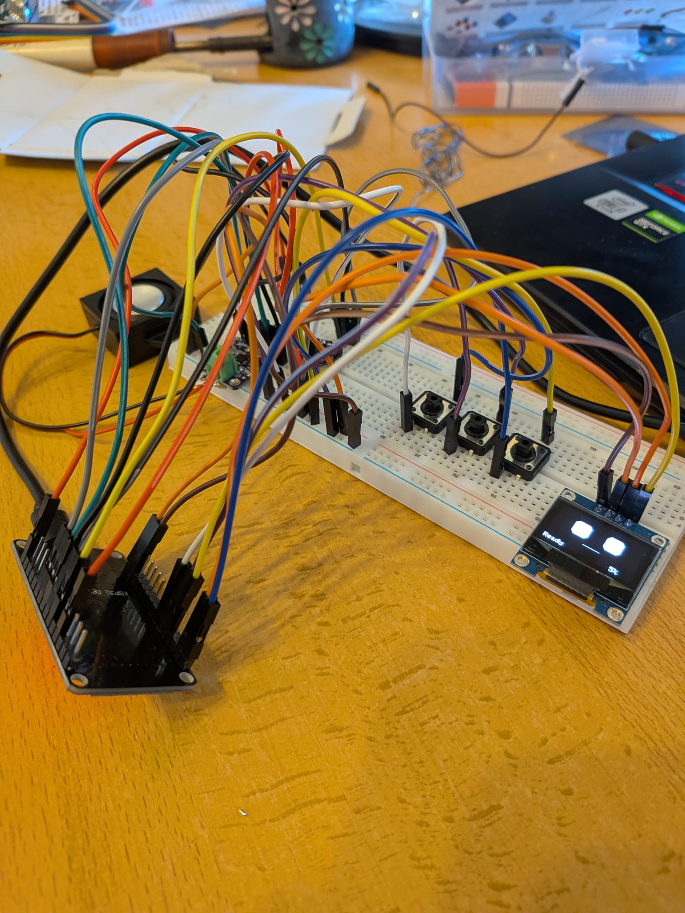

# Maiky the Robot

Desktop companion robot built on an ESP32. Hardware and wiring: [COMPONENTS.md](COMPONENTS.md).

## v0 — hardware test



- **Button 1** (hold): record from the microphone; release to play it back.
- **Button 2**: play a 440 Hz test tone.
- **Button 3**: cycle the volume (5%, 10%, 20%).

## Run the relay

Maiky talks to the AI through a small Cloudflare Worker in [relay/](relay/). It turns your voice into text (Whisper), asks a chat model (Gemma) for an answer, and sends the answer back as speech (MeloTTS). For now it runs on your PC and uses the Workers AI free plan (10,000 neurons per day).

Requires [Node.js](https://nodejs.org/) and a free Cloudflare account.

```sh
cd relay
npm install
cp .dev.vars.example .dev.vars   # then set RELAY_TOKEN to a long random string
npx wrangler login               # once
npm run dev                      # serves POST /talk on port 8787 on every network interface
npm test                         # unit tests, no Cloudflare account needed
```

The AI models always run on Cloudflare, even under `npm run dev`, so every turn uses the free daily quota. If the ESP32 cannot reach the relay, allow port 8787 in the PC firewall.

## Build and flash

Requires [PlatformIO](https://platformio.org/).

```sh
pio run -t upload      # build and flash
pio device monitor     # serial log (115200 baud)
```
