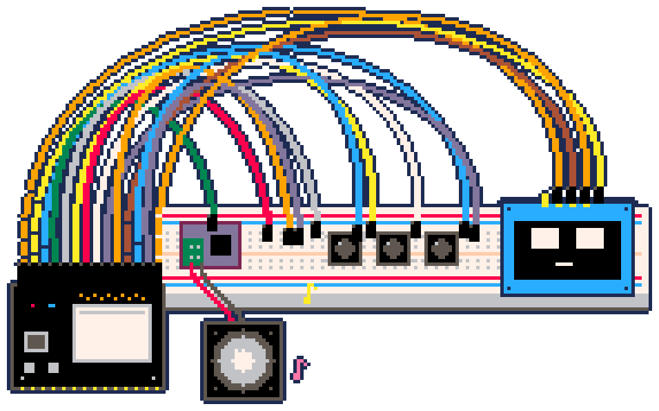

# Maiky the Robot

Desktop companion robot built on an ESP32. Hardware and wiring: [COMPONENTS.md](COMPONENTS.md).

## v1 — talk to Maiky (complete)

Hold a button, ask Maiky something in Spanish, and hear the AI answer through its speaker.



- **Button 1** (hold): ask something; release to hear the answer. The screen shows "Listening...", "Thinking..." and "Speaking...".
- **Button 2**: play a 440 Hz test tone.
- **Button 3**: cycle the volume (5%, 10%, 20%).

Needs the [relay](#run-the-relay) running.

| Screen | Meaning |
|--------|---------|
| No Wi-Fi | Could not join the network in `src/secrets.h`. Button 1 retries. |
| No relay | The relay is not running or not reachable at `RELAY_HOST:RELAY_PORT`. |
| Bad token | `RELAY_TOKEN` differs between `src/secrets.h` and `relay/.dev.vars`. |
| Didn't hear | The relay found no speech in the recording. |
| Error &lt;code&gt; | The relay answered with that HTTP status (502 = an AI service failed or Piper is not running; the relay terminal shows which). |
| Bad audio | The answer was not a 16-bit mono WAV. |

### Limitations

- **No memory.** Every question is independent: Maiky does not remember anything said in earlier turns.
- **No internet access.** Maiky only knows what the chat model learned in training, so it cannot even tell today's date.

## Run the relay

Maiky talks to the AI through a small Cloudflare Worker in [relay/](relay/). It turns your voice into text (Whisper) and asks a chat model (Gemma) for an answer on the Workers AI free plan (10,000 neurons per day), then has a local [Piper](https://github.com/OHF-Voice/piper1-gpl) server speak the answer, in about 0.3 s on a PC without a GPU. For now everything runs on your PC.

Requires [Node.js](https://nodejs.org/), [Python](https://www.python.org/) 3.12 and a free Cloudflare account. First start Piper with a Spanish voice and keep it running (the relay calls it at `http://127.0.0.1:5000`, set by `PIPER_URL` in [relay/wrangler.jsonc](relay/wrangler.jsonc)). Piper and its voices live in the git-ignored `.piper/` folder, away from your global Python. From the repository root, in PowerShell:

```powershell
# Once: create the environment, install Piper and download a voice
# (other voices: es_ES-sharvard-medium, es_MX-claude-high...)
py -3.12 -m venv .piper
.\.piper\Scripts\python -m pip install "piper-tts[http]"
.\.piper\Scripts\python -m piper.download_voices --data-dir .piper es_ES-davefx-medium

# Every time: start the server
.\.piper\Scripts\python -m piper.http_server --data-dir .piper -m es_ES-davefx-medium
```

Then, in another terminal:

```sh
cd relay
npm install
cp .dev.vars.example .dev.vars   # then set RELAY_TOKEN to a long random string
npx wrangler login               # once
npm run dev                      # serves POST /talk on port 8787 on every network interface
npm test                         # unit tests, no Cloudflare account needed
```

Whisper and Gemma always run on Cloudflare, even under `npm run dev`, so every turn uses the free daily quota. If the ESP32 cannot reach the relay, allow `workerd.exe` from `relay\node_modules` on private networks in Windows Firewall.

## Build and flash

Requires [PlatformIO](https://platformio.org/).

```sh
cp src/secrets.example.h src/secrets.h   # then fill in Wi-Fi, the PC's LAN IP and the relay token
pio run -t upload      # build and flash
pio device monitor     # serial log (115200 baud)
```

If PowerShell does not find `pio`, call it as `& "$env:USERPROFILE\.platformio\penv\Scripts\pio.exe"` or add that folder to your user `Path`.

After each question the serial log prints `Sent <bytes>, peak slot0 <a>, slot1 <b>`. While you talk, one slot should peak at a few thousand. Peaks in the hundreds of thousands mean the microphone sends noise, usually a loose jumper on `SD` (GPIO34), and the relay then fails with `Error 502`.
